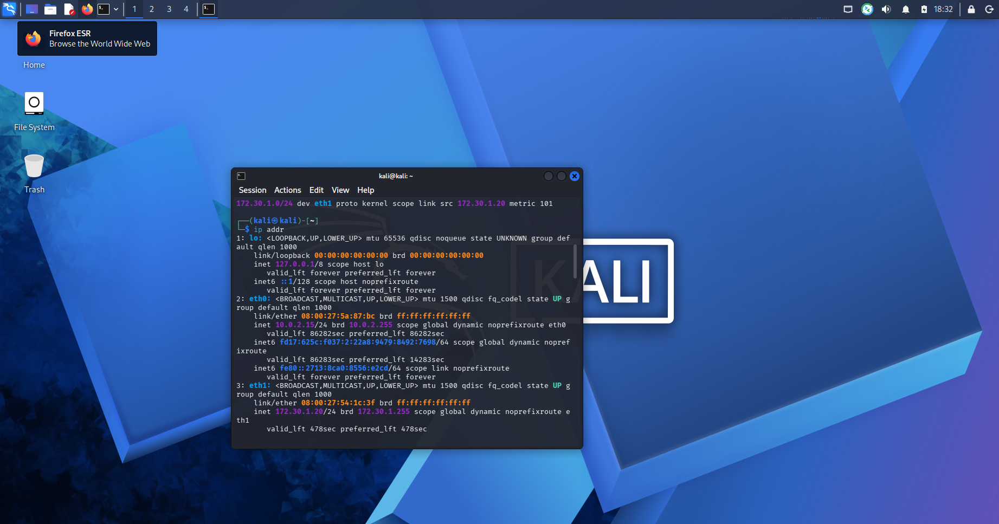
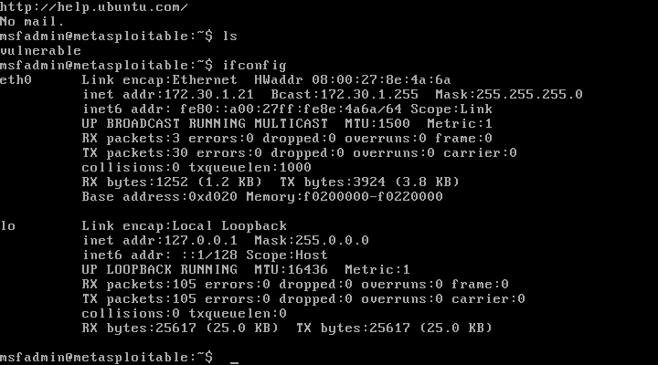
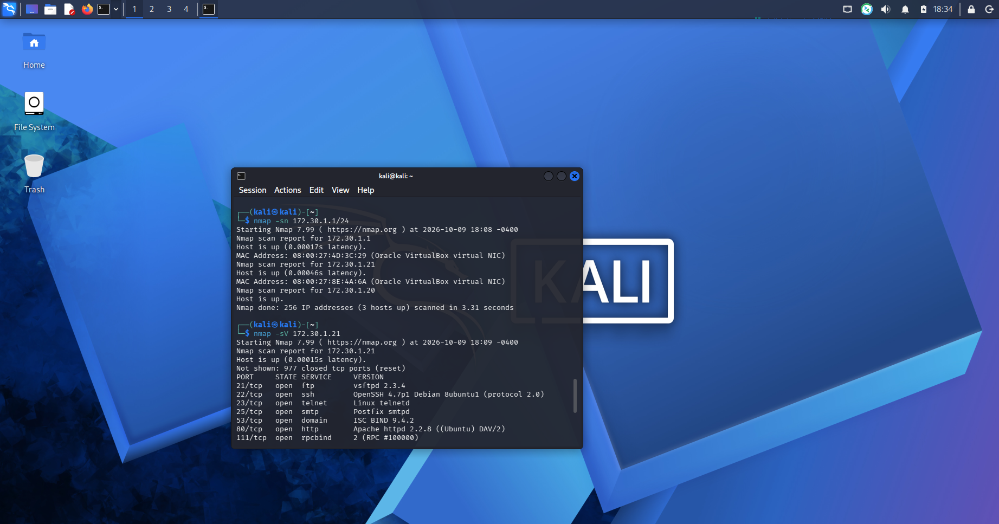
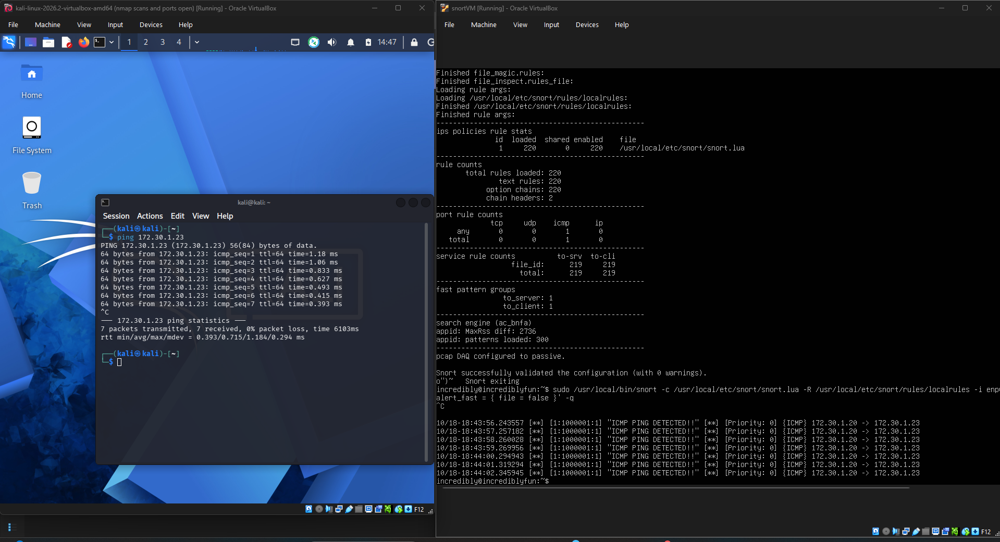
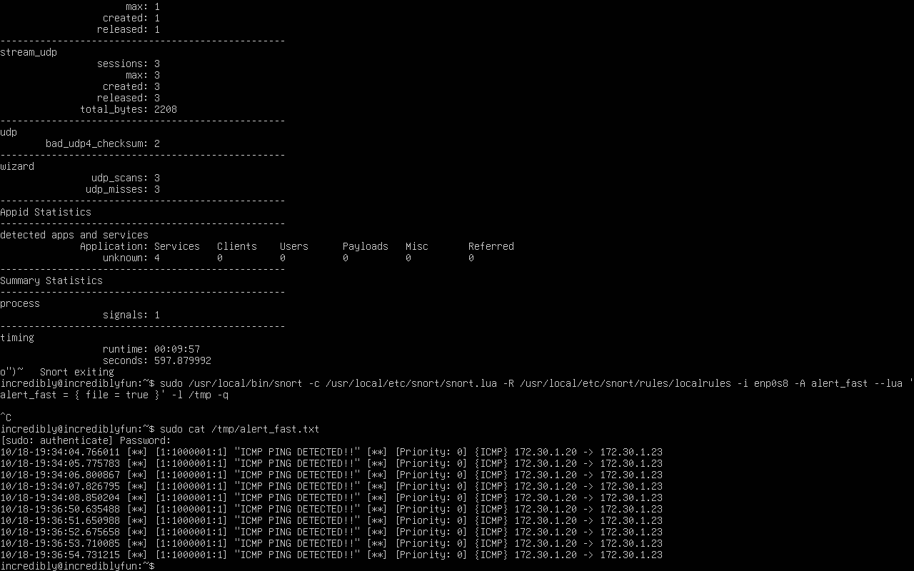

# Snort 3 Intrusion Detection Lab

A hands-on cybersecurity lab implementing Snort 3 as a network intrusion detection system (NIDS) in an Oracle VirtualBox environment. The lab demonstrates virtual network configuration, traffic generation, basic reconnaissance, custom signature development, packet inspection, and alert analysis.

**Project status:** Completed — ICMP detection and saved alert verification successful. Live alert visibility remains an area for improvement.

## Project Overview

I built a virtual cybersecurity testing environment to practice network monitoring and signature-based intrusion detection. I installed **Snort 3.12.2.0** from source on Ubuntu Linux, wrote a custom rule to identify ICMP echo requests, generated test traffic from Kali Linux, and inspected the resulting alerts. I also used a separate Metasploitable VM to practice host discovery and service enumeration with Nmap.

### Objectives

- Configure a controlled virtual network for security testing.
- Install and validate Snort 3 on Ubuntu Linux.
- Establish connectivity between virtual machines.
- Develop and test a custom ICMP detection rule.
- Generate and analyze network traffic and Snort alerts.
- Practice Nmap reconnaissance against a deliberately vulnerable lab target.
- Document troubleshooting and results.

## Lab Environment

| Virtual machine | Role | Lab IP address |
|---|---|---|
| Ubuntu Linux | Snort 3 IDS and packet monitoring | `172.30.1.23` |
| Kali Linux | ICMP traffic generation and Nmap reconnaissance | `172.30.1.20` |
| Metasploitable | Deliberately vulnerable target for reconnaissance | `172.30.1.21` |

**Ubuntu monitoring interface:** `enp0s8`

**Tools:** Oracle VirtualBox, Ubuntu Linux, Kali Linux, Metasploitable, Snort 3.12.2.0, LibDAQ, tcpdump, Nmap, Linux CLI.

> All testing was performed against lab virtual machines. Metasploitable is intentionally vulnerable and should be kept isolated from untrusted networks.

## 1. Network Configuration and Host Discovery

I configured the VMs to communicate over the `172.30.1.0/24` virtual lab network and checked their addresses before running tests.

### Kali Linux network interface

I used `ip addr` to verify Kali's lab-facing address, `172.30.1.20`.



### Metasploitable network interface

On Metasploitable, I ran `ifconfig` and confirmed the target's IP address was `172.30.1.21`.



### Connectivity testing

From Kali, I sent ICMP echo requests to the Metasploitable VM:

```bash
ping 172.30.1.21
```

The target replied, confirming connectivity between those two machines.


I separately verified that Kali could reach the Ubuntu Snort VM at `172.30.1.23`.

## 2. Nmap Reconnaissance of Metasploitable

I used Nmap to discover hosts on the lab subnet and inspect services exposed by the deliberately vulnerable Metasploitable VM.

```bash
nmap -sn 172.30.1.1/24
nmap -sV 172.30.1.21
```

The discovery scan reported three active hosts. The service scan identified multiple open ports on Metasploitable, including FTP (`21/tcp`), SSH (`22/tcp`), Telnet (`23/tcp`), SMTP (`25/tcp`), DNS (`53/tcp`), HTTP (`80/tcp`), and RPC (`111/tcp`). These results demonstrate basic host discovery and service enumeration, **not exploitation**.



**Scope note:** This reconnaissance was a separate exercise from the Snort ICMP rule test. I did not verify that Snort alerted on the Nmap scan.

## 3. Snort 3 Installation and Configuration

I installed **Snort 3.12.2.0** from source on the Ubuntu VM, including its required dependencies such as LibDAQ.

| Component | Path |
|---|---|
| Snort executable | `/usr/local/bin/snort` |
| Main configuration | `/usr/local/etc/snort/snort.lua` |
| Custom rule file | `/usr/local/etc/snort/rules/localrules` |
| Monitored interface | `enp0s8` |

I validated the configuration and custom rules with:

```bash
sudo /usr/local/bin/snort \
  -c /usr/local/etc/snort/snort.lua \
  -R /usr/local/etc/snort/rules/localrules \
  -T
```

Snort reported **successful configuration validation with zero warnings** and **220 loaded rules**, including my custom ICMP rule.

## 4. Custom ICMP Detection Rule

I created the following rule in `/usr/local/etc/snort/rules/localrules`:

```snort
alert icmp any any -> any any (msg:"ICMP PING DETECTED!!"; itype:8; sid:1000001; rev:1;)
```


| Rule field | Meaning |
|---|---|
| `alert` | Generate an alert on a match |
| `icmp` | Inspect ICMP traffic |
| `any any -> any any` | Match traffic regardless of source/destination address (the port fields are placeholders for ICMP) |
| `msg` | Custom alert message |
| `itype:8` | Match ICMP echo requests |
| `sid:1000001` | Custom signature ID |
| `rev:1` | First rule revision |

**Detection context:** Pings are normal diagnostic traffic and are not inherently attacks. I used ICMP as a safe, repeatable event to validate Snort's detection pipeline.

## 5. ICMP Traffic Generation and Detection Testing

I launched Snort against Ubuntu's `enp0s8` interface with the custom rule enabled. For terminal output, I configured the `alert_fast` logger to write to standard output:

```bash
sudo /usr/local/bin/snort \
  -c /usr/local/etc/snort/snort.lua \
  -R /usr/local/etc/snort/rules/localrules \
  -i enp0s8 \
  -A alert_fast \
  --lua 'alert_fast = { file = false }' \
  -q
```

From Kali Linux, I generated ICMP traffic to the Ubuntu IDS host:

```bash
ping 172.30.1.23
```

I also used tcpdump on Ubuntu to confirm that packets reached the monitored interface:

```bash
sudo tcpdump -i enp0s8 -n icmp
```

The screenshot below captures successful ping replies from Ubuntu and Snort's matching alerts. Snort loaded **220 rules** and reported successful validation.



**Observed alert:** Signature `[1:1000001:1]` matched ICMP traffic from `172.30.1.20` to `172.30.1.23`.

## 6. Alert Logging and Analysis

I also tested file-based alert output, directing the fast alert logger to `/tmp`:

```bash
sudo /usr/local/bin/snort \
  -c /usr/local/etc/snort/snort.lua \
  -R /usr/local/etc/snort/rules/localrules \
  -i enp0s8 \
  -A alert_fast \
  --lua 'alert_fast = { file = true }' \
  -l /tmp \
  -q
```

After generating ICMP traffic and stopping Snort, I inspected the log:

```bash
sudo cat /tmp/alert_fast.txt
```

The saved output contained multiple entries resembling:

```text
[1:1000001:1] "ICMP PING DETECTED!!" [Priority: 0] {ICMP} 172.30.1.20 -> 172.30.1.23
```



The log records provide evidence that the custom signature matched traffic, including its timestamp, signature ID, message, protocol, and source/destination IP addresses. **Alerts were confirmed in the saved file; consistent real-time visibility was not established.**

## 7. Troubleshooting and Lessons Learned

### Snort started, but no alerts appeared immediately

- **Symptom:** Snort loaded the custom rule and began processing packets, but the terminal did not initially display alerts while Kali pinged Ubuntu.
- **Investigation:** I checked VM connectivity, confirmed ICMP packets with tcpdump, verified the Snort interface and custom rule, and inspected the alert output configuration.
- **Result:** I confirmed matching alerts in Snort output and the saved alert file. Real-time display behavior remains a future improvement.

### Missing alert file

- **Symptom:** Reading `/tmp/alert_fast.txt` initially returned `No such file or directory`.
- **Investigation:** I inspected `/tmp`, checked whether Snort was running, and reviewed the `alert_fast` output settings.
- **Result:** After enabling file-based fast alerts and running the test, the file was created and could be read with `sudo cat`.

### Terminal and process management

- **Symptom:** Long-running Snort and log-following commands made some terminal sessions difficult to manage.
- **Investigation:** I used additional terminal sessions, process inspection, and `Ctrl+C` to stop foreground commands.
- **Lesson:** Distinguishing an active packet-capture process from a shell prompt is important when troubleshooting Linux security tools.

### Verifying each layer independently

One of the biggest lessons was to test each layer separately: **IP connectivity → packet arrival → rule loading → detection output → saved logs**. This prevented me from assuming that an alert display problem was necessarily a network problem.

## 8. Results

- [x] Built a virtualized cybersecurity testing environment.
- [x] Verified connectivity between Kali, Ubuntu, and Metasploitable as used in the tests.
- [x] Performed Nmap host discovery and service enumeration against Metasploitable.
- [x] Installed and validated Snort 3 on Ubuntu.
- [x] Created a custom ICMP echo-request rule.
- [x] Confirmed traffic visibility with tcpdump.
- [x] Generated ICMP alerts from Kali-to-Ubuntu test traffic.
- [x] Reviewed and documented saved Snort alerts.
- [x] Documented troubleshooting challenges and results.
- [ ] Improve consistent real-time alert visibility.

## 9. Skills Practiced

Network intrusion detection, signature-based rules, packet analysis, Linux administration, virtual networking, Nmap reconnaissance, alert interpretation, command-line troubleshooting, and technical documentation.

## 10. Future Improvements

- Resolve and document real-time alert output behavior.
- Create additional TCP/UDP detection rules and test them with controlled traffic.
- Add packet-capture files or additional alert evidence where appropriate.
- Explore forwarding Snort alerts into a SIEM for easier searching and visualization.
- Expand the Metasploitable exercise while keeping the vulnerable VM isolated.

## Conclusion

This project helped me connect network fundamentals with hands-on intrusion detection. I built a controlled virtual lab, validated a Snort 3 installation, wrote a custom ICMP rule, generated traffic from Kali, and verified matching alerts in both Snort output and saved logs. Troubleshooting taught me to isolate connectivity, packet visibility, configuration, and logging issues rather than treating them as one problem.
